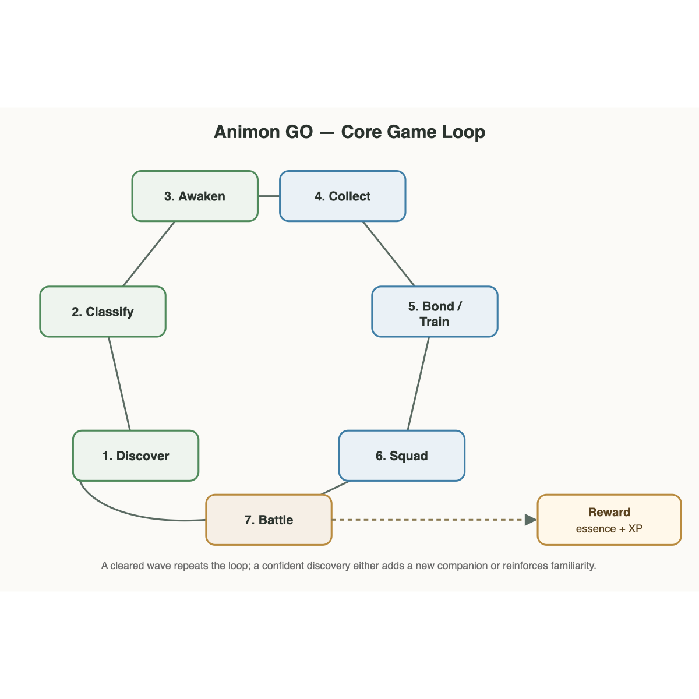
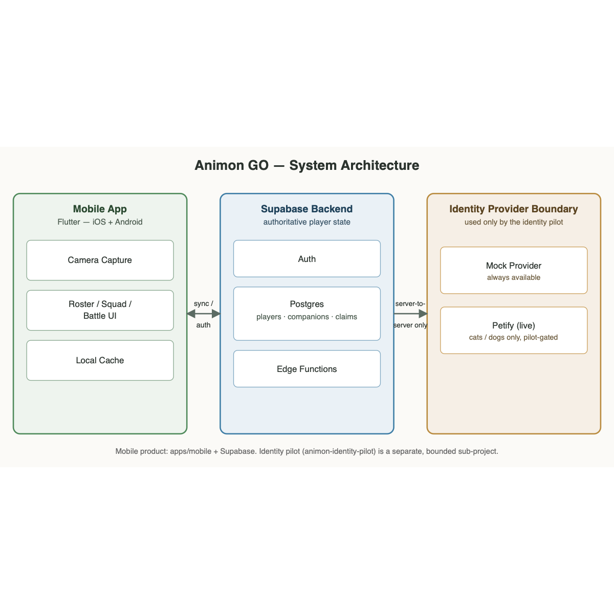

# Animon GO

A location-based mobile game (iOS + Android, Flutter) in the spirit of Pokémon GO: discover real animals in the world, watch them awaken into collectible elemental creatures, bond and train a squad, and battle in PvE trials.



**Status**: pre-implementation. Foundational docs and Spec Kit specs exist; `apps/mobile` is a scaffold, not a playable build yet.

## Start here

| Doc | Answers |
|---|---|
| [`docs/BRD.md`](docs/BRD.md) | Why are we building this? |
| [`docs/PRD.md`](docs/PRD.md) | What should it do? |
| [`docs/SRS.md`](docs/SRS.md) | What are the system requirements? |
| [`docs/ARCHITECTURE.md`](docs/ARCHITECTURE.md) | How is it structured? |
| [`docs/ROADMAP.md`](docs/ROADMAP.md) | What order are we building it in? |

## Architecture



Full write-up: [`docs/ARCHITECTURE.md`](docs/ARCHITECTURE.md).

## Layout

```text
apps/mobile/              The real product — Flutter app (iOS + Android)
animon-identity-pilot/    Bounded Spec Kit sub-project: real-world animal identity pilot
docs/                     BRD, PRD, SRS, Architecture, Roadmap, research, decisions, diagrams
.specify/ · specs/        Spec Kit: constitution and feature specs for the mobile product
```

Two sibling directories exist on the original workstation but are **not part of this repository** and are excluded by `.gitignore`:

- `animon-web/` — a browser reference prototype (its own git repo) that validated the core game loop. Read-only reference for ported design decisions; never edited from here.
- `twntis-film/` — an unrelated project. Not touched, not referenced.

## Working on the mobile app

```sh
cd apps/mobile
flutter pub get
flutter run
```

Feature code lands through the Spec Kit workflow (`/speckit-specify` → `/speckit-plan` → `/speckit-tasks` → `/speckit-implement`), not ad hoc — see [`docs/ARCHITECTURE.md`](docs/ARCHITECTURE.md#2-process-spec-kit-spec-driven-development). The first feature is already specified: [`specs/001-mobile-core-loop/spec.md`](specs/001-mobile-core-loop/spec.md).

## Working on the identity pilot

A bounded experiment to evaluate real-world individual animal recognition (cats/dogs, via Petify) before committing it to the product. See [`docs/research/identity-pilot-setup-plan.md`](docs/research/identity-pilot-setup-plan.md) and [`animon-identity-pilot/README.md`](animon-identity-pilot/README.md). First spec: [`animon-identity-pilot/specs/001-cats-dogs-identity-pilot/spec.md`](animon-identity-pilot/specs/001-cats-dogs-identity-pilot/spec.md).

## Contributing / agent conventions

See [`AGENTS.md`](AGENTS.md) — hard boundaries (never touch `twntis-film`, treat `animon-web` as read-only), where things live, and the Spec Kit process.
