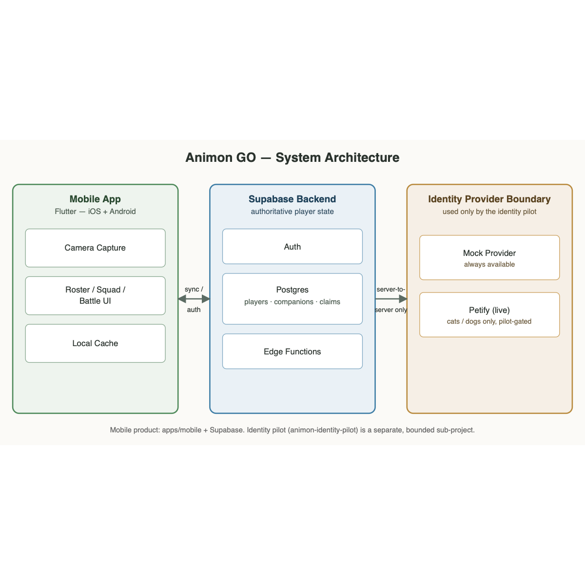
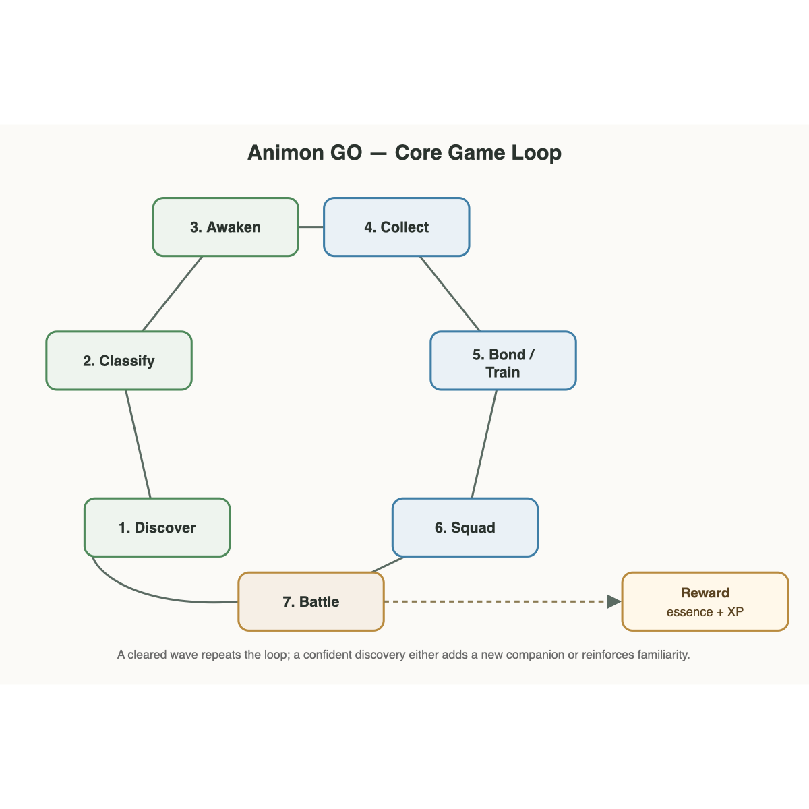

# Architecture Overview — Animon GO

| | |
|---|---|
| **Document owner** | Engineering |
| **Status** | Draft — foundational, for review |
| **Last updated** | 2026-11-05 |
| **Related** | [BRD](BRD.md) · [PRD](PRD.md) · [SRS](SRS.md) · [Roadmap](ROADMAP.md) |

## 0. Diagrams





Source (editable): [`diagrams/system-architecture.svg`](diagrams/system-architecture.svg), [`diagrams/core-game-loop.svg`](diagrams/core-game-loop.svg).

## 1. Repository layout

This is a monorepo. One Git repository at the workspace root tracks the real product, its documentation, and the identity-research sub-project. Two sibling directories are deliberately **outside** this repository's tracked history (see `.gitignore`):

```text
Animon Go/                        # this repo root
├── docs/                         # BRD, PRD, SRS, Architecture, Roadmap, research
│   ├── research/                 # prior R&D, carried over as-is
│   └── decisions/                # ADRs — one file per significant decision
├── apps/
│   └── mobile/                   # the real product: Flutter app (iOS + Android)
├── animon-identity-pilot/        # bounded Spec Kit sub-project: individual animal ID pilot
├── .specify/                     # Spec Kit: constitution, templates, scripts (root/product level)
├── specs/                        # Spec Kit: feature specs for the mobile product
├── animon-web/                   # [git-ignored here] reference prototype, its own repo — read-only
└── twntis-film/                  # [git-ignored here] unrelated project — never touched
```

`animon-web` and `twntis-film` are intentionally excluded from this repository's version control (see root `.gitignore`). `animon-web` remains available on disk as a read-only reference for ported game-design decisions (see [PRD §6](PRD.md#6-game-design-reference-ported-from-the-web-alpha)); it is never edited from this workspace. `twntis-film` is unrelated and must not be read, referenced, or modified as part of this product's work.

## 2. Process: Spec Kit (spec-driven development)

Both the mobile product (root-level `.specify/` + `specs/`) and the identity pilot (`animon-identity-pilot/.specify/` + `.../specs/`) use [GitHub Spec Kit](https://github.com/github/spec-kit) as the spec-first workflow, run as slash commands inside Claude Code:

| Command | Purpose |
|---|---|
| `/speckit-constitution` | Establish non-negotiable project principles |
| `/speckit-specify` | Write a feature's user-facing spec (what/why, not how) |
| `/speckit-clarify` | Resolve ambiguity before planning |
| `/speckit-plan` | Technical design for a spec |
| `/speckit-tasks` | Break a plan into actionable tasks |
| `/speckit-analyze` | Cross-check spec/plan/tasks for gaps |
| `/speckit-implement` | Execute the tasks |

This document and the BRD/PRD/SRS are the **stable baseline** Spec Kit's generated `constitution.md` and feature specs should be consistent with — they are not a replacement for Spec Kit, they are what Spec Kit's constitution and first specs should be seeded from.

## 3. Mobile product architecture (`apps/mobile`)

- **Framework:** Flutter (Dart), targeting iOS and Android from one codebase.
- **Structure** (see `apps/mobile/lib/`):
  - `core/` — theme, shared constants (e.g., the elemental advantage table), stateless utilities.
  - `data/models/` — typed domain models (Family, Element, Creature, Owned, Encounter, Save) ported from [`animon-web/src/lib/data.ts`](../animon-web/src/lib/data.ts).
  - `data/repositories/` — persistence behind one interface, swappable between local cache and Supabase-backed implementations.
  - `features/` — one folder per feature area: `exploration`, `collection`, `battle`, `identity`, `profile`, `onboarding`. Each is reserved scaffolding until its Spec Kit plan/tasks land.
  - `services/` — cross-cutting services: Supabase client, identity-provider adapters, location.
- **State/game logic:** pure, testable game rules (battle math, familiarity, variant resolution) should be ported as plain Dart functions/classes mirroring [`animon-web/src/lib/game.ts`](../animon-web/src/lib/game.ts) — same inputs/outputs, not necessarily same code.

## 4. Backend architecture

- **Platform:** [Supabase](https://supabase.com) — Postgres, Auth, Storage, Edge Functions.
- **Why Postgres matters here:** the one-active-claim-per-animal rule (SRS FR-133) and idempotent reward operations (SRS NFR-REL-1) need real relational constraints and transactions, not a best-effort NoSQL write.
- **Identity provider boundary:** a server-side interface (Edge Function) with:
  - `mock` implementation — always available, clearly labeled, no external calls.
  - `self-hosted` implementation — calls a hosted inference endpoint running a frozen, permissively-licensed pretrained extractor (e.g., DINOv2) to get an image embedding, then matches it ourselves via Postgres `pgvector`; inference credentials never reach the client (SRS SEC-4). See [`docs/decisions/2026-11-05-self-hosted-identity-embeddings.md`](decisions/2026-11-05-self-hosted-identity-embeddings.md).
- **Authoritative state:** currency (essence), XP, and collection claims are validated server-side (SRS FR-161); the client is a view over server state, with local caching for offline play.

## 5. Identity pilot architecture (`animon-identity-pilot`)

A bounded sub-project, not the main product, scoped to answer: *can we reliably recognize the same real cat/dog across different players, phones, and days, without training our own model?* Per [`docs/research/identity-pilot-setup-plan.md`](research/identity-pilot-setup-plan.md):

- Next.js (TypeScript) app for the capture/result/review experience and provider server routes.
- Supabase Auth + Postgres (+ `pgvector`), shared infrastructure choice with the main product (not necessarily the same project/instance at pilot stage).
- A self-hosted embedding + matching pipeline as the live provider: a frozen pretrained extractor (e.g., DINOv2) for embeddings, our own cosine-similarity matching and calibrated thresholds in Postgres; a mock provider for development, always clearly distinguished in stored results. A commercial provider (e.g., Petify) is no longer the default — it may be added later only as a comparison point.
- Its own Spec Kit instance (`animon-identity-pilot/.specify/`), since it has its own constitution emphasis (no new-backbone training, server-verified results, exclusive claims) distinct from the mobile product's broader scope.

This sub-project lives inside the monorepo (per the chosen repo layout) but is tracked with its own `specs/` and does not share Flutter/Dart tooling with `apps/mobile`.

## 6. Data flow (MVP)

```
[Camera] → classify (on-device/edge) → [Flutter app]
                                           │ confident family?
                                           ▼
                              [Supabase Edge Function]
                         (server-validates reward, writes encounter,
                          resolves variant, checks familiarity)
                                           │
                                           ▼
                                [Postgres: player state]
                                           │
                                           ▼
                              [Flutter app renders result]

(Identity pilot, separate flow)
[Capture] → [animon-identity-pilot server route] → [self-hosted embedding + match / mock] → server-verified result
                                                                   → [Postgres + pgvector: animal_identity, exclusive claim]
```

## 7. Decisions log

Significant, hard-to-reverse decisions (stack choices, provider commitments, scope cuts) go in `docs/decisions/` as one short file per decision (what/why/alternatives considered/date), not buried in chat history. Seed decisions already made:

- 2026-11-05 — Mobile stack: Flutter (over React Native/Native/Unity) — chosen for cross-platform velocity with acceptable AR/map plugin support.
- 2026-11-05 — Backend: Supabase (Postgres + Auth + Storage) — chosen for relational integrity needed by exclusive-claim rules, and to match the already-planned identity pilot.
- 2026-11-05 — Repository layout: single monorepo at `Animon Go/` root; `animon-web` and `twntis-film` excluded from version control here.
- 2026-11-05 — Identity pilot: self-hosted embedding + `pgvector` matching replaces Petify as the default live implementation, to avoid recurring per-pet vendor cost and dependency — see [`docs/decisions/2026-11-05-self-hosted-identity-embeddings.md`](decisions/2026-11-05-self-hosted-identity-embeddings.md).
- 2026-11-08 — Model licence screen (YOLO/AGPL, MobileCLIP, OpenAI CLIP weights, MiewID ruled out; ImageNet weights evaluation-only) and an offline evaluation harness at `tools/model-eval/` (research tooling, not a product stack) — see [`docs/decisions/2026-11-08-model-licence-screen.md`](decisions/2026-11-08-model-licence-screen.md).
